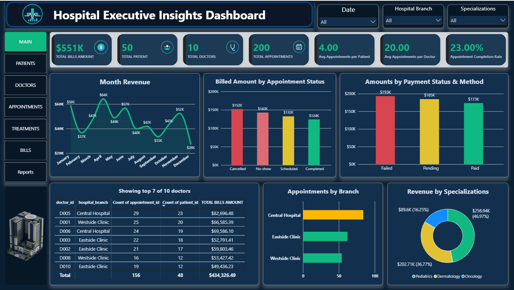
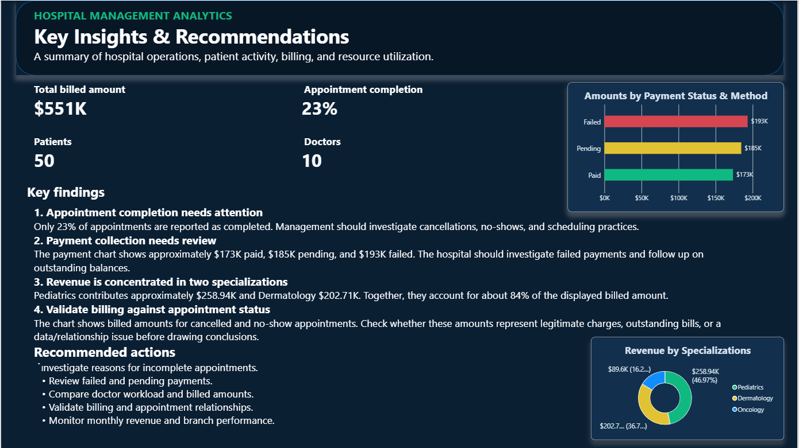

# Hospital Management Analytics — SQL & Power BI

I built this project to explore hospital operations through SQL analysis and interactive Power BI dashboards. The goal was to turn data about patients, doctors, appointments, treatments, and billing into a clearer view of hospital activity and performance.

The project includes SQL queries for business analysis, a Power BI report with multiple dashboard pages, and screenshots that show the results.

**[View the GitHub Repository](https://github.com/SamiUllah568/Hospital-Management-Analytics-SQL-PowerBI)** · **[View the Power BI Report](https://github.com/SamiUllah568/Hospital-Management-Analytics-SQL-PowerBI/blob/main/Hospital%20Analytics.pbix)** · **[View the Dataset](https://github.com/SamiUllah568/Hospital-Management-Analytics-SQL-PowerBI/tree/main/DataSet)**

## Table of Contents

- [Project Overview](#project-overview)
- [Business Questions](#business-questions)
- [Dataset](#dataset)
- [SQL Analysis](#sql-analysis)
- [Power BI Dashboards](#power-bi-dashboards)
- [Key Findings](#key-findings)
- [Recommendations](#recommendations)
- [Tools Used](#tools-used)
- [Repository Contents](#repository-contents)
- [How to Explore the Project](#how-to-explore-the-project)
- [Limitations](#limitations)
- [Contact](#contact)

## Project Overview

Hospital operations involve several connected areas, from patient registration and appointment scheduling to treatments and billing. Looking at these areas separately can make it difficult to understand overall performance.

For this project, I used SQL to analyze hospital-related data and Power BI to present the results through dashboards. The report covers patient activity, doctor performance, appointment status, treatment analysis, payment status, and billed amounts.

The executive dashboard brings several of these metrics together, allowing users to explore overall performance and compare results across hospital branches, specializations, and time periods.

## Business Questions

The analysis focuses on questions such as:

- How many patients, doctors, and appointments are recorded?
- What proportion of appointments are completed?
- How are appointments distributed across completed, scheduled, cancelled, and no-show statuses?
- Which doctors and hospital branches have the highest appointment activity?
- Which specializations account for the largest billed amounts?
- How much is recorded as paid, pending, or failed?
- How do billed amounts change from month to month?
- Which operational or billing patterns deserve further investigation?

These questions help connect the SQL analysis with the metrics presented in the Power BI report.

## Dataset

The project works with five main subject areas:

| Table | Purpose |
|---|---|
| Patients | Patient details and registration information |
| Doctors | Doctor details, specializations, experience, and hospital branches |
| Appointments | Appointment dates, times, reasons, and statuses |
| Treatments | Treatment details, descriptions, dates, and costs |
| Bills | Billing dates, amounts, payment methods, and payment statuses |

The tables support analysis across patient activity, doctor workload, appointment outcomes, treatment costs, and payment records.

- **[Browse the dataset folder](https://github.com/SamiUllah568/Hospital-Management-Analytics-SQL-PowerBI/tree/main/DataSet)**

The data should be interpreted according to its available fields and relationships. Billing and treatment amounts are not, by themselves, evidence of hospital profit.

## SQL Analysis

The SQL work is available in [`SQL ANALYSIS.sql`](https://github.com/SamiUllah568/Hospital-Management-Analytics-SQL-PowerBI/blob/main/SQL%20ANALYSIS.sql).

I used SQL to investigate the different areas of the hospital dataset and answer operational and financial questions. The analysis supports comparisons between patients, doctors, appointments, treatments, and billing records.

The SQL analysis is intended to help answer questions about:

- Patient and doctor activity
- Appointment outcomes and scheduling patterns
- Treatment costs and specialization-level analysis
- Billed amounts and payment statuses
- Doctor and branch performance
- Relationships between operational activity and billing

Open the SQL file to review the queries and their individual logic.

## Power BI Dashboards

The Power BI report presents the analysis through dedicated pages for different areas of hospital performance. The screenshots below provide a preview of the report.

**[Download or open the Power BI report](https://github.com/SamiUllah568/Hospital-Management-Analytics-SQL-PowerBI/blob/main/Hospital%20Analytics.pbix)**

### 1. Executive Insights Dashboard

This page provides an overall view of hospital activity, including key metrics, monthly billed amounts, appointment statuses, payment statuses, branch comparisons, specialization-level billing, and a doctor performance table.



### 2. Patient Dashboard

This page focuses on patient-related analysis. It provides a dedicated view of patient information and activity within the dataset.


### 3. Doctor Dashboard

This page presents doctor-related analysis to help compare activity across doctors and hospital branches.


### 4. Appointments Dashboard

This page focuses on appointment activity and outcomes, supporting analysis of scheduling patterns and appointment statuses.


### 5. Treatment Dashboard

This page presents treatment-related analysis, allowing users to explore treatment activity and associated costs.


### 6. Reports

The repository also includes a report screenshot for additional dashboard content.



*The screenshots are static previews. For interactive filtering and navigation, open the PBIX file in Power BI Desktop.*

## Key Findings

The following figures are displayed in the supplied executive dashboard screenshot. They should be treated as report figures until independently reconciled with the underlying data and measures.

| Metric | Displayed result |
|---|---:|
| Total billed amount | Approximately $551K |
| Patients | 50 |
| Doctors | 10 |
| Appointments | 200 |
| Appointment completion rate | 23% |
| Average appointments per patient | 4.00 |
| Average appointments per doctor | 20.00 |

### Appointment completion

The dashboard reports a completion rate of 23%. This is a useful starting point for investigating appointment outcomes, including cancellations and no-shows. The rate should be checked against the underlying status counts and the measure's definition.

### Payment status

The displayed payment amounts are approximately:

| Payment status | Amount shown |
|---|---:|
| Failed | $193K |
| Pending | $185K |
| Paid | $173K |

The amounts indicate that payment status deserves further review. Failed and pending transactions should be investigated separately because they may have different causes and follow-up requirements.

### Billed amount by specialization

The executive dashboard displays these approximate amounts:

| Specialization | Billed amount shown |
|---|---:|
| Pediatrics | $258.94K |
| Dermatology | $202.71K |
| Oncology | $89.6K |

These figures suggest that the displayed billed amount is concentrated in Pediatrics and Dermatology. Further analysis could examine appointment volumes, treatment patterns, and the number of patients associated with each specialization.

## Recommendations

Based on the patterns displayed in the report, the following areas deserve further investigation:

1. **Review appointment outcomes.** Examine cancellation and no-show patterns and confirm how the completion rate is calculated.
2. **Investigate payment exceptions.** Separate pending payments from failed transactions and identify which records require follow-up.
3. **Validate billing relationships.** Check billed amounts associated with cancelled or no-show appointments against the relevant billing rules and source records.
4. **Compare doctor workload.** Review appointment volumes alongside unique patient counts to understand differences in workload.
5. **Monitor specialization-level billing.** Compare billed amounts with appointment and treatment volumes before drawing conclusions about performance.
6. **Track monthly trends.** Use the report to identify changes in billed amounts and determine whether further investigation is needed.

These are analytical recommendations, not claims that the project has measured real-world financial savings or operational improvements.

## Tools Used

- **SQL** — querying and analyzing the hospital dataset.
- **Microsoft Power BI** — presenting metrics, comparisons, and interactive dashboards.
- **GitHub** — storing and sharing the SQL file, dataset, Power BI report, and screenshots.

## Repository Contents

The repository currently includes the following top-level files and folders:

```text
Hospital-Management-Analytics-SQL-PowerBI/
├── DataSet/
├── Screenshots/
├── Hospital Analytics.pbix
└── SQL ANALYSIS.sql
```

- `DataSet/` — dataset files used in the project.
- `Screenshots/` — dashboard previews.
- `Hospital Analytics.pbix` — Power BI report.
- `SQL ANALYSIS.sql` — SQL analysis queries.

## How to Explore the Project

1. Browse the [dataset folder](https://github.com/SamiUllah568/Hospital-Management-Analytics-SQL-PowerBI/tree/main/DataSet).
2. Open [`SQL ANALYSIS.sql`](https://github.com/SamiUllah568/Hospital-Management-Analytics-SQL-PowerBI/blob/main/SQL%20ANALYSIS.sql) to review the SQL queries.
3. Download [`Hospital Analytics.pbix`](https://github.com/SamiUllah568/Hospital-Management-Analytics-SQL-PowerBI/blob/main/Hospital%20Analytics.pbix).
4. Open the downloaded report in Microsoft Power BI Desktop.
5. Navigate through the report pages and use the available slicers and visuals to explore the data.
6. Browse the [Screenshots folder](https://github.com/SamiUllah568/Hospital-Management-Analytics-SQL-PowerBI/tree/main/Screenshots) for static previews.

## Limitations

- The displayed figures should be validated against the dataset and the Power BI measures before being used for formal reporting.
- Billed amounts should not be interpreted as profit because operating expenses and other cost information have not been established.
- Payment statuses require careful interpretation; a failed transaction does not necessarily mean the amount is permanently uncollectible.
- Any relationship between appointment status and billing should be checked against the underlying records and business rules.
- The results describe patterns in this dataset and should not be treated as proof of causation or as findings about every hospital.

## Contact

**Sami Ullah**

- **LinkedIn:** [Connect with me](https://www.linkedin.com/in/sami-ullah-b10b93300)
- **Email:** [sk2579784@gmail.com](mailto:sk2579784@gmail.com)
- **GitHub:** [Hospital Management Analytics — SQL & Power BI](https://github.com/SamiUllah568/Hospital-Management-Analytics-SQL-PowerBI)

This project is part of my data analytics portfolio and demonstrates my work with SQL analysis, Power BI dashboards, and business-focused reporting.
